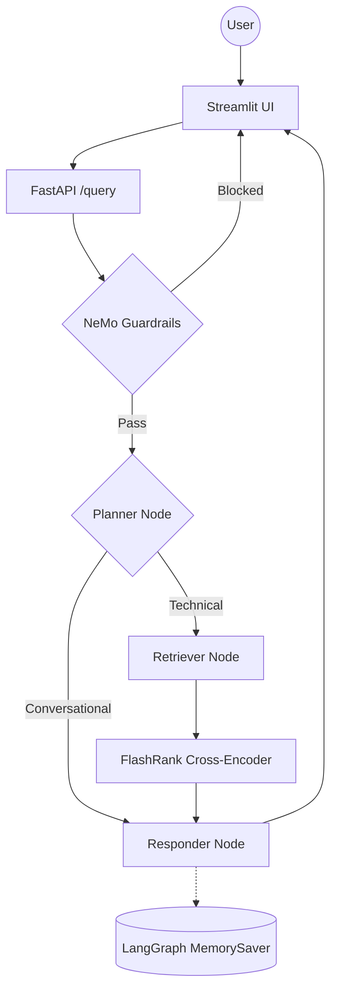

# Enterprise Agentic RAG (Scalable Pipeline)

A production-grade, enterprise-level RAG system built with **LangGraph**, **Groq models**, optional **Portkey routing**, and **AICredits embeddings** with local **FlashRank** reranking. The system distinguishes between technical "True Data" and random "Noisy Data" using semantic re-ranking, history-aware planning, and NeMo Guardrails for input/output safety.

## Key Features

- **Agentic Routing**: LangGraph decides per turn whether to search the documents, answer from conversation memory, or decline.
- **Guardrails**: NeMo Guardrails gate blocks off-topic, jailbreak, and injection inputs before any retrieval.
- **LLM Gateway**: Groq direct calls using `openai/gpt-oss-120b` for the main RAG path and `openai/gpt-oss-20b` for the guardrail gate, with optional Portkey routing when configured.
- **Enterprise Search**: Qdrant Cloud for high-performance vector search + local FlashRank reranking for semantic refinement.
- **Embedding Backend**: OpenAI-compatible `text-embedding-3-large` via the AICredits gateway, with local `sentence-transformers` fallback (`all-mpnet-base-v2`).
- **Local Document Parsing**: PDF, HTML, TXT, DOCX, PPTX parsed entirely on-device — no external OCR service.
- **Observability**: Nested **Pydantic Logfire** spans across every agent node, retrieval call and gateway request.
- **Visible Reasoning**: `/query` returns the agent's plan and retrieved sources, both rendered in the Streamlit UI.
- **Synchronous `/query`**: The LangGraph pipeline runs directly inside the `/query` endpoint and returns the final answer.
- **Evaluation Suite**: RAGAS eval pipeline (6 metrics — 5 LLM-judged plus a zero-LLM Jaccard tool-correctness check) with a dedicated Streamlit demo app.

---

## Agent Intelligence Flow



---

## Project Structure

```text
├── app/
│   ├── agents/
│   │   └── nodes/       # Planner, Retriever, Responder LangGraph nodes
│   ├── gateway/         # Portkey LLM gateway — primary + fallback Groq routing
│   ├── guardrails/      # NeMo Guardrails input/output filtering
│   ├── ingestion/
│   │   ├── chunking/    # Paragraph-based text splitter (1500 char max)
│   │   └── loaders/     # Local parsers — PDF (pypdf), HTML, TXT, DOCX, PPTX
│   ├── services/
│   │   └── retrieval/   # AICredits embeddings + Qdrant search + local FlashRank reranking
│   ├── config.py        # Centralized environment variable management
│   └── main.py          # FastAPI entrypoint — guardrails gate + /query endpoint
├── evals/               # RAGAS evaluation suite + Streamlit 3-tab demo
├── ui/                  # Streamlit landing page + chat interface with reasoning transparency
├── processed_data/      # Auto-generated — parsed & chunked JSON output per document
├── DATA/                # Sample datasets (True vs Noisy documentation)
├── Dockerfile           # Container definition (retained for reference)
└── requirements.txt     # Pinned dependencies
```

---

## Tech Stack

| Layer | Technology |
|-------|-----------|
| Orchestration | LangChain + LangGraph |
| LLMs | Groq `openai/gpt-oss-120b` for the main pipeline, `openai/gpt-oss-20b` for the guardrail gate |
| Guardrails | NeMo Guardrails |
| Vector DB | Qdrant Cloud |
| Reranking | Local FlashRank ONNX cross-encoder (`TinyBERT`) |
| Embeddings | AICredits `text-embedding-3-large` via OpenAI-compatible API + local `sentence-transformers` fallback |
| Document Parsing | pypdf + pdfplumber (local, no OCR service) |
| Observability | Pydantic Logfire |
| Evaluation | RAGAS + custom Tool Correctness (Jaccard) |

---

## Getting Started

### 1. Install dependencies

```powershell
python -m venv tenvv
.\tenvv\Scripts\activate
pip install -r requirements.txt
```

### 2. Configure environment

Create a `.env` file with the following keys:

```env
GROQ_API_KEY=
USE_PORTKEY=false
PORTKEY_API_KEY=
PORTKEY_CONFIG_SLUG=
QDRANT_API_KEY=
QDRANT_CLUSTER_ENDPOINT=https://your-cluster.cloud.qdrant.io:6333
EMBEDDING_PROVIDER=aicredits
AICREDITS_API_KEY=
AICREDITS_BASE_URL=https://api.aicredits.in/v1
AICREDITS_EMBEDDING_MODEL=text-embedding-3-large
EMBEDDING_BATCH_SIZE=50
EMBEDDING_ALLOW_LOCAL_FALLBACK=true
GUARD_FALLBACK_ENABLED=true
RETRIEVER_CANDIDATES=8
RERANK_TOP_N=5
RERANK_MAX_LENGTH=256
RERANK_ENABLED=true
RERANK_CACHE_DIR=/tmp/flashrank
LOGFIRE_TOKEN=
```

> **Note:** embeddings come from an OpenAI-compatible gateway and reranking runs
> locally via FlashRank (ONNX) — there is no Jina AI key. Persistence is
> in-process (`MemorySaver`), so there is no Postgres or Redis to configure;
> see [Design decisions](#design-decisions-worth-arguing-with).
>
> `.env` is gitignored. `.env.example` is the annotated reference and is the
> file to copy.

### 3. Run data ingestion

Parses all documents in `DATA/`, chunks them, saves metadata to `processed_data/`, and indexes vectors into Qdrant.

```powershell
python -m app.ingestion.processor DATA --wipe
```

> Pass `--wipe` to drop and recreate the Qdrant collection. Omit it to append to an existing collection.

### 4. Launch the app

The `/query` endpoint runs the LangGraph pipeline synchronously. You only need the FastAPI server and (optionally) the Streamlit UI. There is no external database to run — conversation memory is an in-process `MemorySaver` keyed by `thread_id`, so it resets when the server restarts.

```powershell
# Terminal 1 — FastAPI backend
uvicorn app.main:app --reload --port 8000

# Terminal 2 — Streamlit UI
streamlit run ui/app.py
```

The UI opens on a landing page and switches to the chat in-session. Set `BACKEND_URL` if the API is not on `http://localhost:8000`.

### 5. Query the API

```powershell
curl -X POST "http://localhost:8000/query" `
  -H "Content-Type: application/json" `
  -d '{"q": "How do I start Redis for a Kubernetes work queue?", "thread_id": "user-1"}'

# Response: {"question": "...", "answer": "...", "thought_process": [...], "status": "...", "sources": [...]}
```

### 6. Run the eval suite

```powershell
# Streamlit demo (requires the backend on :8000)
streamlit run evals/app.py
```

`evals/pipeline.py` is a library rather than a CLI: `run_pipeline()` is driven from the demo app against a golden dataset.

### 7. Run tests locally

```powershell
# Lint + format checks
ruff check app tests evals
ruff format --check app tests evals

# Unit tests
$env:LOGFIRE_IGNORE_NO_CONFIG=1
pytest tests/
```

---

*Built for High-Scale Enterprise Document Intelligence.*